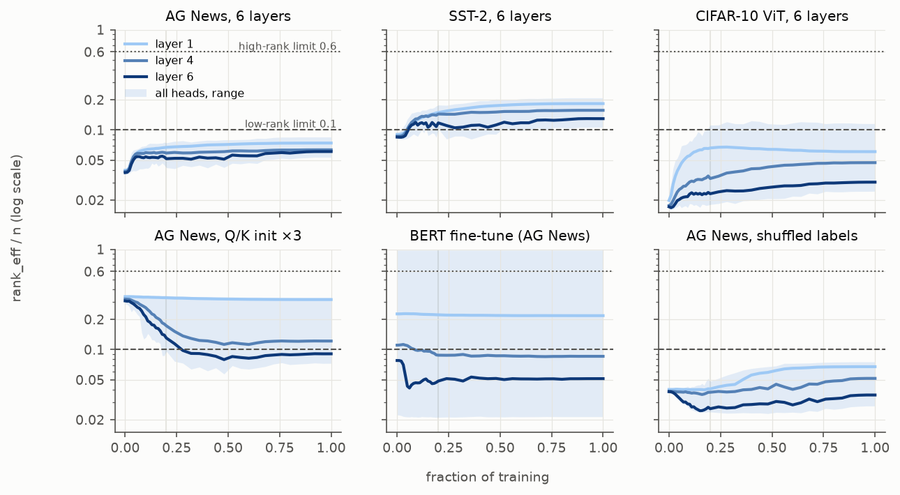
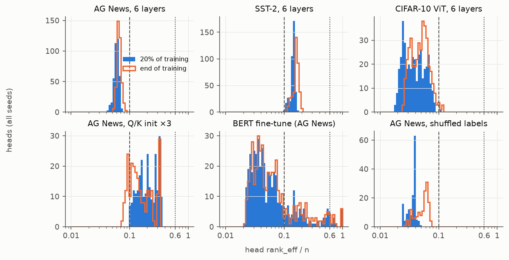
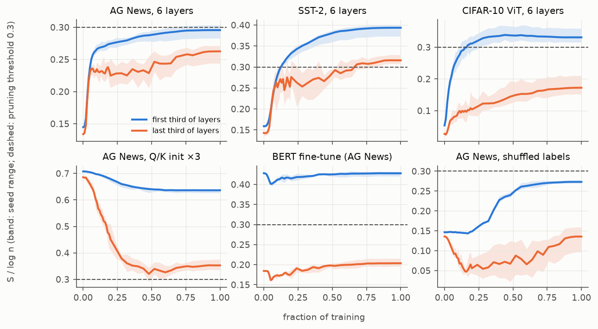
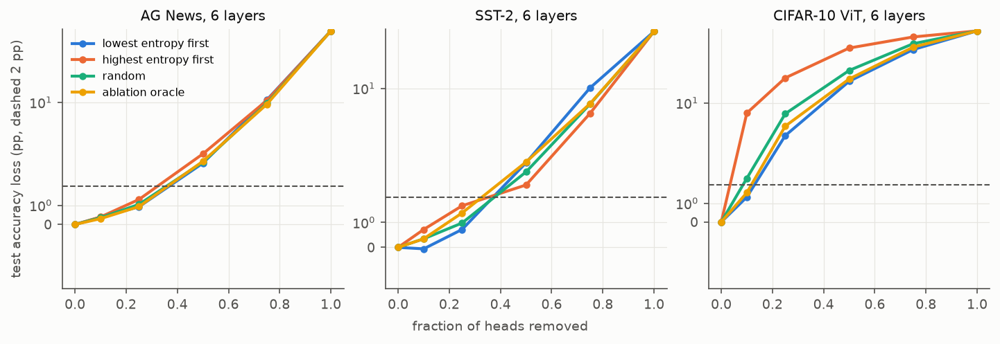
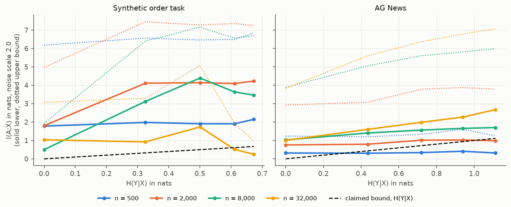
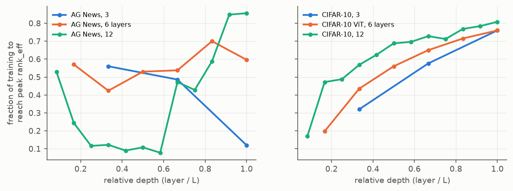

# Spectral Dynamics of Attention Matrices During Training: Rank Evolution and Entropy Bounds

## 1. Executive Summary

**Question.** Do attention heads follow five claimed dynamics: bifurcation into high- and low-rank populations, layer-specific entropy shapes, safe entropy-threshold pruning, a mutual-information bound I(A;X) ≤ H(Y|X) + O(1/√n), and depth-accelerated rank collapse?

**Answer.** Four of the five claims fail as stated, and the fifth holds only in narrow conditions. We trained 68 transformers (13 configurations; text, vision, pretrained BERT) with per-head tracking at 41 checkpoints, plus 120 runs with controlled H(Y|X). No run in any configuration met the bifurcation criterion. With default initialisation, attention does not collapse at all: it *starts* nearly uniform (low rank) and von Neumann entropy *rises*. Rank collapse does appear when attention starts sharply peaked, and it grows with depth, but layer 6 reached its minimum about 1.8× faster than layer 1 rather than 3–5×. Under default initialisation, the 0.3·log(n) threshold removed 63–96% of heads on AG News and CIFAR-10 at a cost of 19–45 pp. Only SST-2 met the pruning criterion, and there entropy did no better than random selection. The MI bound is false: Proposition 1 gives a counterexample, and measured information stayed well above it at perfect accuracy, with an excess that did not shrink as n grew.

**Practical implications.** Do not use a fixed 0.3·log(n) cut-off to prune heads. Do not describe attention training as "rank collapse" without stating the initial state, since initialisation sets the direction. On vision models, entropy is a useful *ranking* signal for pruning (low-entropy-first beat random by 3–13 pp in CIFAR-10 arms at the threshold's head count), but this does not carry over to text. The variance bound in §5.4 is a valid replacement for the proposed MI bound.

| Claim | Verdict | Key evidence |
|---|---|---|
| H1 Bifurcation by 20% | **Refuted** | 0/68 runs meet the criterion under any of 5 rank definitions; heads form one population; dip test significant in 3/68 runs (chance level) |
| H2 Early monotone fall, late U | **Refuted** (default init) | Early monotone fall in 0% of default-arm layers; late U in 0–5%. Late U appears only under ×3 init or without signal |
| H3 Prune S < 0.3 log n, <2% loss | **Refuted in general** | Passes in 1 of 11 signal configurations (SST-2, 13.8% of heads, no better than random) |
| H4 I(A;X) ≤ H(Y|X) + O(1/√n) | **Refuted** | Proposition 1; at H(Y|X)=0 and 100% accuracy, I ≥ 1.04 nats (ε=2), implied constant rises with n |
| H5 Final layer 3–5× faster to minimum | **Refuted** (default init); **direction only** under large init | Default: the minimum is at initialisation, so the ratio is undefined. Large init: 1.8 (CI 1.6–2.0) |

## 2. Research Question & Hypothesis

Five sub-claims were tested with numerical criteria frozen in `planning.md` before any full run. A claim counts as supported in a configuration if its criterion holds in at least 80% of seeds.

Why it matters: spectral structure is cheap to measure. If it predicted head fate early, it could guide pruning and low-rank acceleration. Existing evidence comes largely from finished models, so the trajectory itself is under-studied.

## 3. Literature Review Summary

The resource-finder stage was skipped for this workspace, so the review (`literature_review.md`) was compiled by hand from web searches. No PDFs were downloaded, so these summaries rest on abstracts and search excerpts rather than full-text reading.

- **Head pruning.** Michel et al. (2019) rank heads by loss change on removal and report removing up to 60% without loss, task-dependently. Voita et al. (2019) prune 38/48 encoder heads with L0 gates for a 0.15 BLEU cost. Neither uses a spectral threshold.
- **Spectra.** Linformer (Wang et al., 2020) shows long-tailed spectra in trained models, more skewed in higher layers. "Mind the Gap" (arXiv 2410.07799) studies rank collapse at initialisation. Effective-rank definitions vary (Roy & Vetterli, 2007, among others), so we check several.
- **Information.** For deterministic networks, MI with the input is constant (discrete X) or infinite (continuous X) (Saxe et al., 2018; Goldfeld et al., 2019), so estimates depend on a regulariser. We use a Gaussian channel with pairwise-distance bounds (Kolchinsky & Tracey, 2017; the paper's details are from memory, as the search did not surface it, but `src/test_units.py` confirms the bounds bracket a Monte-Carlo estimate on a known mixture).

## 4. Methodology

### Definitions
A head's attention A(x) is n×n and row-stochastic, where n counts non-pad tokens including CLS. With singular values σᵢ:

- **Von Neumann entropy:** S = −Σ pᵢ log pᵢ, pᵢ = σᵢ²/Σσ² (eigenvalues of ρ = AAᵀ/tr AAᵀ). S ranges over [0, log n].
- **rank_eff = exp(S)** (primary). Also checked: stable rank, intrinsic rank (Σσ)²/Σσ², Roy–Vetterli exp H(σ/Σσ), numerical rank (σ > 1% σ₁).
- **Row entropy** (mean Shannon entropy of rows ÷ log n): distinguishes uniform attention (rank 1, row entropy 1) from pointer attention (rank 1, row entropy 0).

A head's value is its mean over 256 fixed dev inputs, in eval mode. Important consequence: uniform attention has S = 0, so a "near-uniform" head is low-rank.

### Models and data
Custom encoder (d=192, 8 heads, GELU, CLS pooling, pre-LN unless stated), AdamW with warm-up and cosine decay, gradient clipping at 1.0.

| Configuration | Data | Layers | Seeds | Steps | Test accuracy (%) |
|---|---|---:|---:|---:|---:|
| `ag_L3` / `ag_L6` / `ag_L12` | AG News, len ≤ 64, mean n 46 | 3 / 6 / 12 | 5 / 8 / 5 | 5,526 | 91.8 / 92.1 / 92.1 |
| `sst_L6` | SST-2 phrases, tested on sentences, mean n 22 | 6 | 8 | 3,156 | 81.1 |
| `cifar_L3` / `cifar_L6` / `cifar_L12` | CIFAR-10, 4×4 patches, n = 65 | 3 / 6 / 12 | 5 / 8 / 5 | 7,480 | 79.5 / 81.4 / 81.9 |
| `ag_L6_postln` | AG News, post-LN | 6 | 5 | 5,526 | 92.1 |
| `ag_L6_bigqk` / `cifar_L6_bigqk` | Q and K init ×3 (post-plan) | 6 | 5 / 5 | as above | 91.3 / 78.0 |
| `ag_L6_shuffled` / `cifar_L6_shuffled` | Shuffled train labels | 6 | 3 / 3 | as above | 24.7 / 11.3 (chance) |
| `bert_ag` | BERT-base fine-tune, 40k AG News, 1 epoch | 12 (12 heads) | 3 | 1,250 | 92.5 |

Accuracies are in line with what small from-scratch models usually reach on these tasks, and shuffled-label runs land at chance. The ×3 initialisation costs 0.8 pp on AG News and 3.4 pp on CIFAR-10.

### Pruning (H3)
Heads are ranked by S/log n on the probe set. Removal zeroes a head's output with no rescaling and no fine-tuning (primary). Baselines at the same head count: 10 random draws, highest entropy first, and an ablation oracle (single-head accuracy drop on dev). Secondary arm: fine-tuning for 5% of training steps at lr/10. SST-2 test uses half of the 872 labelled validation sentences (official test labels are hidden), so one sentence is 0.23 pp.

### Mutual information (H4)
120 runs (4 layers, d=128, 3,000 steps, 3 seeds) over η ∈ {0,.1,.2,.3,.4} × n ∈ {500, 2k, 8k, 32k} training samples × 2 tasks. **Order task:** 32 tokens, label says whether marker a precedes marker b, so noise-free H(Y|X) = 0 exactly. **AG News:** the same, with baseline H(Y|X) assumed ≈ 0. Symmetric label noise gives exactly H(Y|X) = h₂(η) + η log(K−1).

Since A is deterministic, I(A;X) needs a regulariser. We estimate I(A+εZ; X) over M = 2,000 test inputs. The pairwise bounds Î_BD ≤ I ≤ Î_KL are both capped at log M = 7.6 nats, and ε ∈ {0.2, 0.5, 1, 2, 4}. We rerun on M = 250 to detect the ceiling: ε ≤ 1 is ceiling-affected, while ε ≥ 2 is not (M=250 and M=2,000 agree). **ε=2 is therefore the reporting scale. This choice was made after seeing the data**, but all five scales are in `results/h4_regression.csv`. "n" in the claim is unspecified, and we read it as the training-set size.

### Environment and reproducibility
Python 3.12.12, PyTorch 2.15.0, NumPy 2.5.4, SciPy 1.18.1, statsmodels 0.15.0, shared 4× NVIDIA RTX A6000 (48 GB each, usually under 7 GB free). Batch sizes: 128 (text), 256 (CIFAR), 32 (BERT), 64 (MI). No mixed precision. Training time per job under contention: 3–56 min. Seeds 0–7. A same-seed rerun of `ag_L6` reproduced test accuracy and every logged spectral value bit-for-bit (`results/repro_check.txt`). No LLM API was needed or used, and API cost was $0: all models were trained locally because model internals are required.

**Statistics.** The seed is the unit of inference. CIs are 10,000-resample bootstraps over seeds, which are coarse at 3–5 seeds. Hartigan's dip test for bimodality. One-sided t-tests against 2 pp with Holm correction across configurations. Wilcoxon or t-tests for paired baseline comparisons.

## 5. Key Findings

### 5.1 H1: no bifurcation; heads form one population

*Figure 1. rank_eff/n over training. Thick lines: layers 1, middle, last (seed means). Band: range over all heads and seeds. Dashed and dotted lines: claimed 0.1 and 0.6 limits.*

| Configuration | Share > 0.6n | Share < 0.1n | Between | Median rank_eff/n | Mean dip p |
|---|---:|---:|---:|---:|---:|
| ag_L6 | 0.000 | 1.000 | 0.000 | 0.060 | .63 |
| sst_L6 | 0.000 | 0.000 | 1.000 | 0.144 | .83 |
| cifar_L6 | 0.000 | 0.997 | 0.003 | 0.036 | .74 |
| ag_L6_bigqk | 0.000 | 0.012 | 0.988 | 0.200 | .35 |
| bert_ag | 0.030 | 0.778 | 0.192 | 0.047 | .99 |

*Values at 20% of training, mean over seeds.*

- **0 of 68 runs** meet the criterion under any of the five rank definitions, at 20% or at the end of training. Definitions move the population as a whole (numerical rank places SST-2's heads mostly above 0.6n; stable rank places them all below 0.1n), but none splits it.
- The dip test reached p<.05 in 3/68 runs (4.4%), about what chance predicts.
- Under rank_eff, only BERT has heads above 0.6n: 4% at the start and 3% at the end, in layers 1, 3, 4 and 6. These come from pretraining, not from this training run.
- Head fate is partly settled by 20%: Spearman between a head's rank at 20% and at the end is 0.70–0.98 in most configurations. The exception is `ag_L12`, at 0.32. So ordering becomes stable early, but as a continuum, not as two groups.

*Figure 2. Distribution of head rank_eff/n at 20% of training and at the end, all seeds.*

### 5.2 H2: entropy rises, with no monotone fall or late U under default init

*Figure 3. S/log n for the first and last thirds of layers. Band: seed range. Dashed: pruning threshold 0.3.*

| Configuration | S/log n, start → end (early layers) | Same (late layers) | Early monotone fall | Early monotone rise | Late U |
|---|---:|---:|---:|---:|---:|
| ag_L6 | .145 → .296 | .134 → .263 | 0% | 94% | 0% |
| sst_L6 | .159 → .394 | .143 → .316 | 0% | 100% | 0% |
| cifar_L6 | .053 → .331 | .027 → .172 | 0% | 50% | 0% |
| ag_L12 | .142 → .274 | .118 → .256 | 0% | 35% | 5% |
| ag_L6_bigqk | .708 → .636 | .686 → .353 | 50% | 0% | 0% |
| cifar_L6_bigqk | .367 → .419 | .322 → .213 | 0% | 10% | **100%** |
| ag_L6_shuffled | .146 → .273 | .136 → .136 | 0% | 50% | **100%** (3 seeds) |
| bert_ag | .428 → .428 | .184 → .204 | 0% | 17% | 67% |

*Percentages are shares of (seed, layer) cells in that band.*

- The hypothesised pairing, early monotone fall with late U, occurs in **no configuration**.
- In default runs the rise is fast: 77–86% of the total rank increase occurs in the first 10% of training on AG News (L=3, 6, 12 and post-LN), 52–60% on SST-2 and CIFAR-10 at L=3, 6, and 45% on CIFAR-10 at L=12.
- A late U does occur when the network has either a high initial entropy (`cifar_L6_bigqk`) or no learnable signal (`ag_L6_shuffled`). So the U seems to be a transient of early over-concentration, not a depth law. `ag_L6_bigqk`, with the same init, shows a late fall without the rebound, so even this is not general.
- Early CIFAR layers overshoot: their entropy peaks around 40% of training, then declines slightly, the reverse of a U.

### 5.3 H3: the threshold is not a safe pruning rule

| Configuration | Share pruned at τ=0.3 | Loss (pp) [95% CI] | Random | High-S first | Oracle | Holm p (<2 pp) |
|---|---:|---:|---:|---:|---:|---:|
| **sst_L6** | **13.8%** | **0.12 [−0.43, 0.75]** | 0.47 | 1.03 | 0.55 | **.004** |
| ag_L6_bigqk | 3.8% (vacuous, <5%) | 0.12 [0.01, 0.27] | 0.24 | 0.22 | 0.26 | <.001 |
| ag_L3 | 95.8% | 45.3 [42.4, 48.2] | 42.1 | 39.2 | 43.3 | 1 |
| ag_L6 | 84.9% | 19.3 [16.4, 22.0] | 17.9 | 18.4 | 19.0 | 1 |
| ag_L12 | 90.2% | 24.1 [15.9, 31.6] | 25.8 | 23.7 | 24.2 | 1 |
| ag_L6_postln | 89.2% | 28.6 [20.4, 39.7] | 26.2 | 30.0 | 25.1 | 1 |
| cifar_L3 | 63.3% | 36.7 [28.2, 44.8] | 40.0 | 47.0 | 36.6 | 1 |
| cifar_L6 | 66.9% | 32.8 [28.8, 37.1] | 41.3 | 56.5 | 35.6 | 1 |
| cifar_L12 | 70.0% | 27.6 [23.8, 32.2] | 40.3 | 58.5 | 32.5 | 1 |
| cifar_L6_bigqk | 46.7% | 19.5 [17.5, 21.4] | 22.6 | 46.4 | 16.2 | 1 |
| bert_ag | 64.4% | 40.9 [15.3, 58.6] | 13.6 | 25.5 | 7.6 | 1 |

*Figure 4. Accuracy loss against share of heads removed. Vertical axis is symmetric-log; dashed line: 2 pp.*

- **Why it fails:** most heads lie *below* 0.3·log n, because attention is near-uniform. The threshold selects most of the model, not a redundant minority. SST-2's normalised entropy ends higher (.32–.39 vs .26–.30 on AG News, with mean n 22 vs 46), so few heads fall below the line. This may be a sequence-length effect, which we did not test separately.
- **SST-2:** the loss meets the criterion, yet entropy adds nothing: low-S vs random difference −0.36 pp (Wilcoxon p = .25). With 436 test sentences, this is a weak comparison.
- **Fine-tuning** recovers much but not enough: AG News 19.3 → 10.4 pp, CIFAR-10 32.8 → 8.5 pp, SST-2 0.12 → 0.12 pp.
- **Entropy is a real signal on CIFAR-10 but not on text.** At the threshold's head count, low-S first beats random (cifar_L6: −8.5 pp, p = .008; L12: −12.7 pp, p = .005; L3: −3.2 pp, p = .002). Removing high-entropy heads first costs far more (56.5 pp vs 32.8 pp). Spearman of S with ablation importance is +0.23 to +0.40 on CIFAR-10, and near zero on default-init text (−0.14 to +0.11). The ablation oracle does not always beat it, because single-head importance is a poor guide to joint removal.
- **On BERT, low-S pruning was worse than random**, by 27 pp, though imprecisely (3 seeds, p = .12).
- Cutting only 25% of heads, AG News and SST-2 lose ~1 pp under any selection rule, which echoes Michel et al.: much head removal is cheap regardless of method. CIFAR-10 at 25% loses 4.6 pp with low-S first vs 19.8 pp with high-S first.

### 5.4 H4: the bound is false

**Proposition 1 (counterexample).** Let X be uniform on M ≥ 2 inputs and Y = f(X), so H(Y|X) = 0. Take any network computing f whose attention map x ↦ A(x) is injective on those inputs, with that head's output weight in W_O set to zero. Then predictions are unaffected, and since A is a function of X, I(A;X) = H(A) = log M for every n. The right side of the claim tends to 0. ∎

The claim cannot be rescued by the training-set size: I(A;X) is a property of the map, and nothing forces a Bayes-optimal network's attention to discard input information. The direction is also suspect. The data-processing inequality gives I(A;Y) ≤ I(X;Y) = H(Y) − H(Y|X), which *falls* with H(Y|X), whereas the claim rises with it.

**Proposition 2 (valid replacement).** For T = A(X) + εZ, Z standard Gaussian: I(T;X) ≤ min{log M, E‖A(X) − Ā‖²_F / (2ε²)}. Proof: I(T;X) = E KL(N(A(X), ε²I) ‖ P_T) ≤ E KL(N(A(X), ε²I) ‖ N(Ā, ε²I)) = E‖A(X) − Ā‖²_F/(2ε²), the inequality holding because the true marginal minimises this expected KL. ∎ So what bounds the information is attention *variability* relative to the noise, and H(Y|X) does not appear. Empirically, Î_BD stayed below this bound in all 19,200 checks (every layer, noise scale and checkpoint). Î_KL may exceed it, since Jensen only gives Î_KL ≤ 2× the bound.

*Figure 5. Estimated I(A;X) at ε=2, mean over layers and seeds. Solid: lower bound. Dotted: upper bound. Dashed black: claimed H(Y|X) with the O(1/√n) term set to zero.*

| Noise-free runs, ε=2 | n=500 | n=2,000 | n=8,000 | n=32,000 |
|---|---:|---:|---:|---:|
| Order task: Î_BD, nats (test accuracy) | 1.78 (49%) | 1.80 (99%) | 0.50 (100%) | 1.04 (100%) |
| Order task: implied C = excess × √n | 40 | 81 | 45 | 186 |
| AG News: Î_BD, nats (test accuracy) | 0.32 (63%) | 0.76 (76%) | 1.03 (83%) | 1.01 (87%) |
| AG News: implied C | 7 | 34 | 92 | 180 |

- **Lower bounds exceed the claim:** Î_BD is a certified lower bound on the regularised I, so at H(Y|X)=0 and perfect accuracy, the regularised information is at least 1.04 nats (order task, n=32,000), where the claim allows only C/179.
- **The violation is common but not universal.** At ε=2, Î_BD exceeds H(Y|X) + 1/√n in 93% of order-task and 73% of AG News runs. It lies below the claimed value mainly in noisy cells: AG News at small n (e.g. η=0.4, n=500: 0.32 vs 1.11 nats) and the order task at n=32,000 with η ≥ 0.3. Those cells are consistent with the claim only because I is low, not because it tracks H(Y|X).
- **The excess does not vanish with n.** A true O(1/√n) term needs bounded C, yet implied C grows from 7 to 180 on AG News and, non-monotonically, from 40 to 186 on the order task.
- **Regression Î = a + b·H + c/√n fails its criterion at every scale.** ε=2: order a = 1.38 [0.71, 2.05], b = 1.94 [0.70, 3.17]; AG a = 1.58 [1.43, 1.74], b = 0.59 [0.35, 0.82]. Where b's CI includes 1 (order ε=0.5, 1, 2; AG ε=1), the intercept is 1.4–5.5 nats, not ≈ 0. On AG News, c is negative at every scale: information *rises* with n, the opposite of the claimed term.
- **Label noise does raise I**, which fits the claim in sign only: at n=32,000 on AG News, I goes from 1.0 to 2.7 nats as η goes from 0 to 0.4. The likely mechanism is memorisation of noisy labels, not a fundamental limit.
- **Saturation is partial.** At n=8,000, AG News plateaus by 40% of training and the noise-free order task by 20%. The order task at η=0.2 was still rising late (0.5 nats at 20% of training, 3.8 at 60%, 4.4 at the end). Plateaus do not sit at H(Y|X).
- **The estimate depends on ε by orders of magnitude**, and large ε can make it pass trivially: at ε=4, noise-free order runs at n=8,000 reach 0.13 nats. Any fixed I value here is a statement about ε. That is why we rest the refutation on Proposition 1 and on the *trend* in n, not on one number.
- An untrained network already exceeds the claim at low ε (AG News at ε=1: Î_BD = 0.65 nats at step 0).

### 5.5 H5: no collapse under default init; depth effect under large init is below the claim

*Figure 6. Fraction of training for rank_eff to reach its peak, by relative depth and network size (default init).*

| Configuration | t_min layer 1 | t_min last layer | Ratio [95% CI] | Rank drop layer 1 → last | Reading |
|---|---:|---:|---:|---:|---|
| ag_L3, ag_L6, cifar_L3 | 0 | 0 | undefined | 0 (rank rises) | Minimum is at initialisation |
| ag_L12, cifar_L6, cifar_L12, sst_L6 | ≤ .001 | .010–.124 | ≈ 0 | ≈ 0 | Same |
| ag_L6_bigqk | .69 | .38 | **1.81 [1.63, 2.00]** | 7% → 75% | Real collapse, below 3× |
| cifar_L6_bigqk | .002 | .14 | 0.01 [0, .04] | 0.4% → 60% | Layer 1 never falls |
| bert_ag | .63 | .05 | 11.9 [10.0, 14.4] | 4% → 47% | Layer 1 hardly falls, so ratio is unstable |

- The prespecified criterion needs a fall of at least 10% in both layers. **No run of any configuration satisfies it.**
- Under default init, rank moves from `rank_eff/n` ≈ .04 → .07 (AG, layer 1), .09 → .18 (SST-2), .02 → .06 (CIFAR-10): the reverse of collapse.
- Post-hoc rise-time ratios (time to *peak*, layer 1 ÷ last) have no consistent sign: AG 7.8, 2.1, 0.63 for L = 3, 6, 12; CIFAR-10 0.42, 0.26, 0.21; SST-2 3.7 [2.4, 5.0]. SST-2 overlaps 3–5, but it measures a different quantity on a post-hoc basis.
- **What holds up:** a strong depth gradient in collapse *magnitude* when attention starts peaked (AG: 7, 36, 56, 66, 70, 75% from layer 1 to 6; CIFAR-10: 0.4, 14, 30, 42, 53, 60%), matching BERT's 4% → 47%. Also, layer 1 has higher rank than the last layer at 95–100% of checkpoints in every configuration, though not always in strict order across intermediate layers. Linformer's report of more skewed spectra in higher layers agrees with this.

## 6. Discussion

**Why the framing failed.** The hypothesis imagines full-rank matrices collapsing. With standard initialisation, scaled-dot-product attention begins near-uniform (row entropy ≈ 0.99) because Q and K are small, so A is close to a rank-one matrix, and learning *builds* structure. The ×3 arm is the crucial control: when attention starts peaked (rank_eff/n ≈ 0.32), rank falls, with depth. Rank therefore moves towards an intermediate band from either side, and both AG arms end near .06–.14 of n. Rank collapse is a matter of the start state, and "attention gets more low-rank in training" is not a general property.

**Comparison with expectations.** Our planning expectation of rising rank and H4's failure on the noise-free task were both confirmed. We did not anticipate that entropy would be informative for pruning on vision but not text. One possible reason is that CIFAR-10's fixed grid gives heads stable spatial roles, whereas text attention varies by input, but we did not test this.

**Alternative explanations.** *Small models:* BERT, far larger and pretrained, is also unimodal and mostly low-rank (dip p = .99). It starts peaked (row entropy ≈ 0.50) and its last layers lose rank during fine-tuning, which agrees with the ×3 arm. *Pre-LN:* post-LN matched it almost exactly. *CLS pooling:* constant across arms, and not varied. *Averaging across inputs:* per-head means could hide per-input bimodality, a real limitation (§7).

## 7. Limitations

- **Scope.** Small encoders and short fine-tunes, using classification on three datasets. CLS pooling throughout. Deep ImageNet-scale ViTs, decoders and large language models were not studied. The bifurcation claim might hold there, but nothing here suggests it.
- **Definitions.** rank_eff and S were our choices, since the hypothesis did not define them. Five definitions were checked for H1, but S also depends on using ρ = AAᵀ. Head values average over inputs.
- **Post-plan analyses.** The ×3 init arm, rise-time ratios, ε=2 as reporting scale and paired baseline tests were not pre-registered, and only one gain value was tested. They are exploratory.
- **H3.** SST-2 evaluation has 436 sentences. BERT has 3 seeds and very wide CIs, and fine-tuning was not run on BERT or on configurations outside L=6 default arms. Zeroing a head without rescaling is one possible removal method.
- **H4.** Noise channels define a quantity only relative to ε. AG News's intrinsic H(Y|X) is assumed ≈ 0, and is really some unknown small positive value, though the order task has no such issue. Training failed at small n on the order task (test accuracy ≈ 50% for n=500 and noisy n=2,000), which complicates its n-trends, and the 3-seed cell means are noisy, as seen in non-monotone order-task values. The reading of "n" as training-set size is an assumption, and "our derived bound" was not available to inspect: a derivation with stronger assumptions (e.g. stochastic attention, or a different left side such as I(A;Y)) could survive, but it would not be this claim.
- **Infrastructure.** Shared GPUs caused 200 out-of-memory restarts. Interrupted jobs restarted from scratch, so these should not affect results, and the rerun was bit-identical, but that rerun covered one configuration on one GPU type.
- **Time-to-minimum** uses a 5% tolerance on 41 checkpoints. Differences under about 1% of training can't be resolved early on, or 4% later.

## 8. Conclusions & Next Steps

Attention heads in these models do not split into high- and low-rank populations. Under standard initialisation they start near-uniform and gain rank, so "rank collapse" as a universal training dynamic is wrong. The bound I(A;X) ≤ H(Y|X) + O(1/√n) is false, while Proposition 2's variance bound is valid. The 0.3·log n pruning rule is unsafe, though entropy does carry pruning information on vision tasks. The one finding that survives in a modified form is that collapse from peaked starts grows strongly with depth.

Recommended follow-ups:

1. Sweep the Q/K init gain and softmax temperature to map the attractor band for rank.
2. Replace the fixed threshold with a per-layer entropy rank for ViTs, and test it on larger models.
3. Test whether stable spatial roles explain vision's entropy–importance link.
4. Analyse per-input distributions, since per-head means may hide input-level bimodality.
5. If a derivation of the bound exists, identify its assumptions and retest those.

## 9. Deviations from Plan

Listed in `planning.md`: the MI noise grid moved up after a pilot; the ×3 init arm was added post hoc; the literature was compiled by hand; entropy–importance correlation was added; fine-tuning moved into its own script (L=6 default arms only). Also, the job queue was reordered mid-run so that MI ran before the remaining depth repeats, and GPU memory reservations were lowered so that MI and BERT could start. All planned seeds finished.

## 10. Output Files

`results/accuracy.csv`, `results/h1*.csv`, `results/h2*.csv`, `results/h3*.csv`, `results/h4*.csv`, `results/h5*.csv`, `results/repro_check.txt`, raw per-run data in `results/runs/` and `results/mi/`, figures in `figures/`.

## 11. References

- Goldfeld, Z. et al. (2019). Estimating Information Flow in Deep Neural Networks. ICML.
- Hartigan, J. A. & Hartigan, P. M. (1985). The Dip Test of Unimodality. Annals of Statistics.
- Kolchinsky, A. & Tracey, B. D. (2017). Estimating Mixture Entropy with Pairwise Distances. Entropy.
- Michel, P., Levy, O. & Neubig, G. (2019). Are Sixteen Heads Really Better than One? NeurIPS. https://aihub.org/2020/03/26/are-sixteen-heads-really-better-than-one
- Naderi, A. et al. Mind the Gap: a Spectral Analysis of Rank Collapse. arXiv:2410.07799. https://arxiv.org/abs/2410.07799v1
- Roy, O. & Vetterli, M. (2007). The Effective Rank: A Measure of Effective Dimensionality. EUSIPCO.
- Saxe, A. M. et al. (2018). On the Information Bottleneck Theory of Deep Learning. ICLR.
- Voita, E. et al. (2019). Analyzing Multi-Head Self-Attention: Specialized Heads Do the Heavy Lifting, the Rest Can Be Pruned. ACL. https://arxiv.org/abs/1905.09418
- Wang, S. et al. (2020). Linformer: Self-Attention with Linear Complexity. arXiv:2006.04768. https://arxiv.org/pdf/2006.04768
- Datasets: AG News (`fancyzhx/ag_news`), SST-2 (`stanfordnlp/sst2`), CIFAR-10 (`uoft-cs/cifar10`). Model: `google-bert/bert-base-uncased`.
